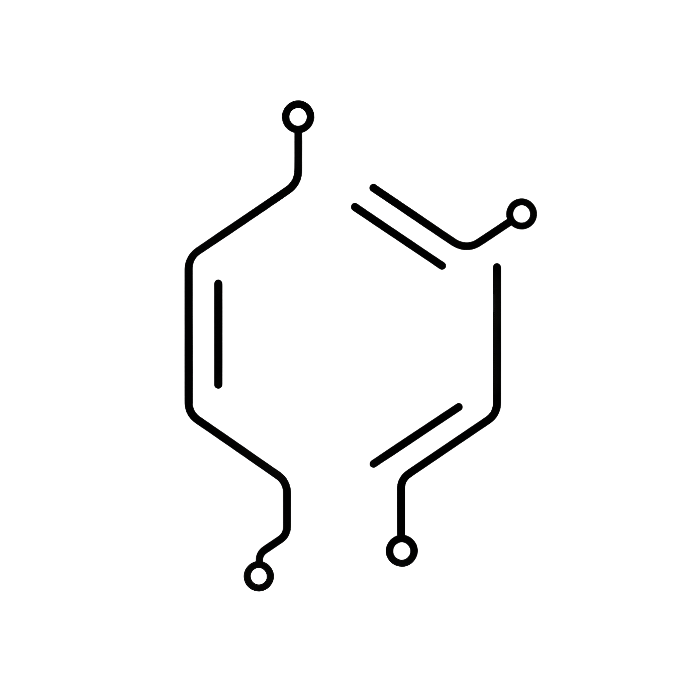

# Benzene-0.2-Alkane



**国际象棋神经网络 · 6.85M 参数 · 从零训练**

Benzene-0.2 是 Benzene 系列的国际象棋方向。0.2 采用化学分子命名，
每个分子是一个独立型号，对应一种棋力性格。

<br clear="left"/>

## 型号系列

| 型号 | 化学含义 | 定位 | 参数 | 状态 |
|---|---|---|---|---|
| **Alkane** | 烷 · 单键饱和，最稳定 | 稳健基线 | **6.85M** | ✅ 本仓库 |
| Alkene | 烯 · 双键活泼 | 深算型 | 132.82M | 待数据 |
| Alkyne | 炔 · 三键高能 | 激进主义 | 派生 | 规划中 |
| Phenol | 苯酚 · 苯系母体 | 最强型 | 15.72M | ✅ 已训 |

**Alkane 是整个系列的起点** —— 最小、最稳、最容易复现。

---

## 这是什么

AlphaZero 风格的棋类神经网络。给定局面，输出：

- **policy**：4,672 个走法的概率分布
- **value**：当前走子方的胜率估计，范围 [-1, 1]

配合 MCTS 搜索即可对弈。

**它不是 Stockfish 的对手。** 棋力约 1100-1200 Elo（业余入门），
但这是一个**完整、可复现、不依赖任何现成棋类模型**的起点。

## 架构

```
输入    19 × 8 × 8 特征平面
         0-5   己方 兵车马象后王
         6-11  对方 兵车马象后王
         12-15 王车易位权利
         16    吃过路兵目标
         17    轮到谁走
         18    回合数 / 100

主干    ResNet 6 块 × 128 通道
policy  Conv1×1(128→16) → FC(1024 → 4672)
value   Conv1×1(128→32) → FC(2048→128) → FC(128→1) → tanh
```

**参数量 6,855,568**，其中 policy 头占约 70%。

## 训练

**数据**：107,224 个局面，来自 Stockfish 19 自我对弈

```
对局数      1,000 局
搜索深度    depth 8
候选走法    MultiPV 3
价值标签    tanh(cp / 400)
分布        胜 11.8% · 均 77.1% · 败 11.1%
```

**训练**：CPU，7 个 epoch 后过拟合停止

| epoch | 验证 loss | top-1 |
|---|---|---|
| 1 | 4.2639 | 25.8% |
| 2 | 3.7157 | 34.0% |
| 3 | 3.5847 | 38.0% |
| **4** | **3.4607** | **40.5%** ← 最优 |
| 5 | 3.7331 | 42.3% |
| 6 | 3.5520 | 42.3% |

**分段准确率**：开局 56.7% · 中局 36.3% · 后中局 33.2%

## 用法

```bash
python src/serve_chess.py --ckpt weights/benzene-0.2-alkane.pt --port 8766
# 浏览器打开 http://127.0.0.1:8766
```

支持难度选择（200/800/1600/3200 次 MCTS），可导出 PGN。

### 在棋类软件里使用（UCI 协议）

`src/uci.py` 实现了 UCI 协议，可以直接接入 CuteChess、Arena、
Lichess（配合 lichess-bot）、Fritz、ChessBase 等任何支持 UCI 的软件。

```
命令:  python
参数:  /path/to/src/uci.py --ckpt /path/to/benzene-0.2-alkane.pt --sims 800
```

命令行测试：

```bash
echo -e "uci\nisready\nposition startpos\ngo movetime 1000\nquit" | \
    python src/uci.py --ckpt weights/benzene-0.2-alkane.pt
```

支持的选项：`Simulations`（默认 800）


## 已知限制

**① 过拟合**：训练 loss 1.0，验证停在 3.46。64 样本/参数，远低于经验比例。

**② 中后局弱**：开局 56.7% → 中局 36.3% → 后中局 33.2%，残局几乎靠猜。

**③ 棋力有限**：对 Stockfish skill level 0（约 1350 Elo）四局全负。

**④ 搜索加深无益**：800 次 vs 1600 次 MCTS，得分率仅 25%。

## 文件

```
benzene-0.2-alkane.pt     79 MB  权重
src/                      11 个脚本（棋盘编码、网络、MCTS、对弈界面、训练）
assets/                   图标与立绘
```

代码仓库：https://github.com/CollinsLiu615/Benzene-0.2-Alkane

## 立绘说明

右侧形象图由 **Seedream 5.5**（模型 id `seedream5.5`）AI 生成，
描绘 Benzene 形象手持黑白棋子。

图标是电路板风格的苯环，呼应系列的化学命名。


## 致谢

- **Stockfish 19** —— 训练标签来自 depth 8 自我对弈
- **python-chess** —— 棋盘表示、走法生成、PGN 处理
- **PyTorch** —— 全部在 CPU 上训练，未用 GPU

## 许可

**CC BY-NC 4.0**（[署名—非商业性使用 4.0 国际](LICENSE)）

### 可以做什么

- **共享**：以任何媒介或形式复制、发行本作品
- **改编**：修改、转换或以本作品为基础进行创作
- 用于研究、教育、个人学习与评测

### 不可以做什么

- **商业性使用**
- 以其它许可条款再授权

### 必须做什么

- 署名 **CollinsLiu615**
- 附上许可协议链接
- 说明是否作了修改

适用范围：模型权重、训练流程、图标与立绘（由 Seedream 5.5 生成）。

训练数据来自 Stockfish 自我对弈，本身无版权问题；非商业限制是项目层面的
选择，让 0.1 与 0.2 整个系列使用同一许可。
