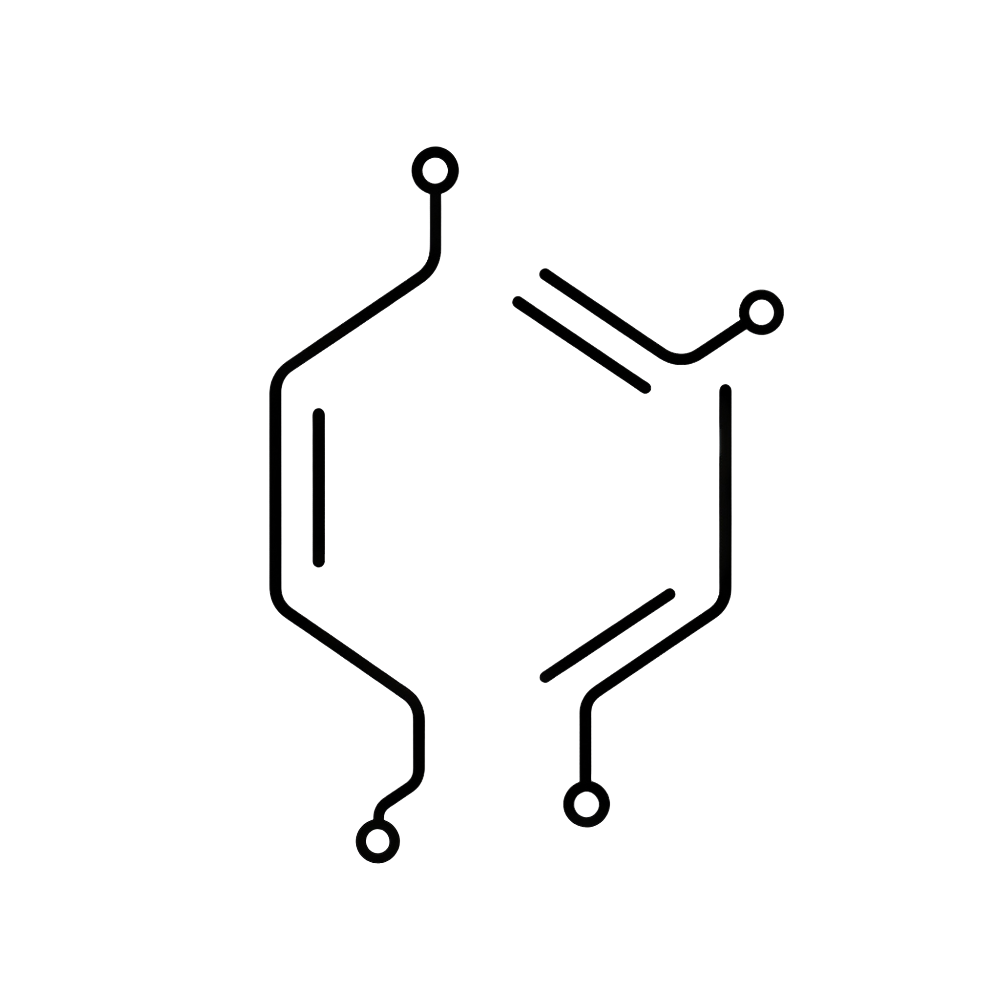
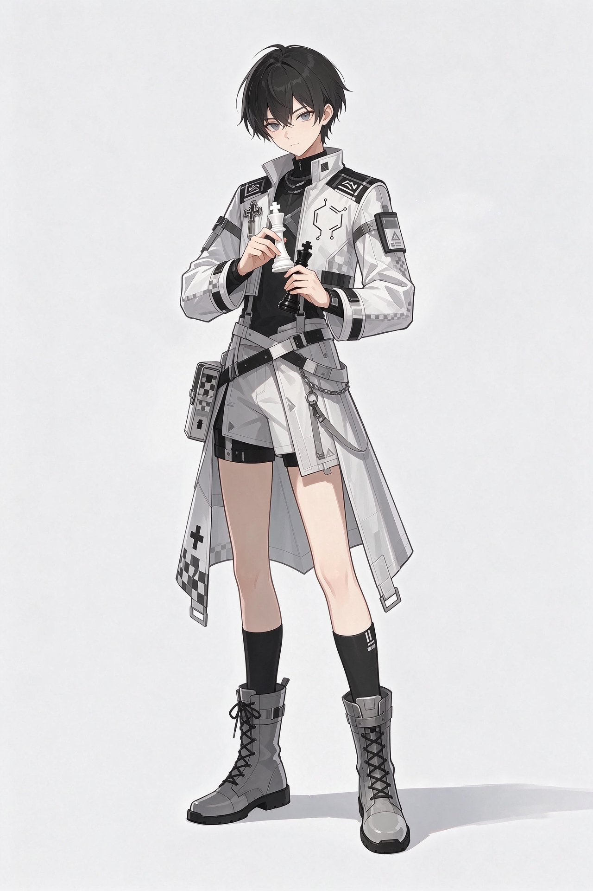

# Benzene-0.2-Alkane



**Chess neural network · 6.85M parameters · trained from scratch**

Benzene-0.2 is the chess line of the Benzene series. 0.2 uses chemical molecule
names, where each molecule is an independent model variant with its own
playing personality.

<br clear="left"/>

| Variant | Chemistry | Role | Params | Status |
|---|---|---|---|---|
| **Alkane** | Saturated single bonds — the most stable | Stable baseline | **6.85M** | ✅ This release |
| Alkene | Reactive double bonds | Deep search | 132.82M | Awaiting data |
| Alkyne | High-energy triple bonds | Aggressive | derived | Planned |
| Phenol | Aromatic parent structure | Strongest | 15.72M | ✅ Trained |

**Alkane is where the series begins** — the smallest, most stable, and easiest
to reproduce.

---

## What this is

An AlphaZero-style chess neural network. Given a position it outputs:

- **policy** — a probability distribution over 4,672 moves
- **value** — win probability for the side to move, in [-1, 1]

Pair it with MCTS to play.

**It is not a Stockfish competitor.** Playing strength is around club-beginner
level (~1100 Elo estimated), but it is a complete, reproducible,
trained-from-scratch starting point — no existing chess model was used.

---

## Architecture

```
Input   19 × 8 × 8 feature planes
          0-5    own   pawn knight bishop rook queen king
          6-11   enemy pawn knight bishop rook queen king
          12-15  castling rights
          16     en-passant target
          17     side to move
          18     move number / 100

Trunk   ResNet, 6 blocks × 128 channels
          stem   Conv3×3(19→128) + BN + ReLU
          block  Conv3×3 → BN → ReLU → Conv3×3 → BN, residual add

policy  Conv1×1(128→16) → FC(1024 → 4672)
        4,672 = 8×8×73  (64 squares × 73 move types:
                          56 sliding + 8 knight + 9 pawn)

value   Conv1×1(128→32) → FC(2048→128) → FC(128→1) → tanh
```

**6,855,568 parameters**, of which the policy head holds roughly 70%
(4,672 outputs × 1,024 inputs).

---

## Training

**Data**: 107,224 positions from Stockfish 19 self-play

```
Games          1,000
Search depth   8
Candidates     MultiPV 3
Policy labels  softmax over the top-3 moves (temperature 100 cp)
Value labels   tanh(cp / 400)
Distribution   win 11.8% · draw 77.1% · loss 11.1%
```

**Training**: CPU, stopped after 7 epochs due to overfitting

| epoch | val loss | top-1 accuracy |
|---|---|---|
| 1 | 4.2639 | 25.8% |
| 2 | 3.7157 | 34.0% |
| 3 | 3.5847 | 38.0% |
| **4** | **3.4607** | **40.5%** ← best |
| 5 | 3.7331 | 42.3% |
| 6 | 3.5520 | 42.3% |

**Per-phase accuracy** (validation set):

| Phase | top-1 |
|---|---|
| Opening, moves 1-15 | 56.7% |
| Middlegame, 15-35 | 36.3% |
| Late middlegame, 35-80 | 33.2% |

---

---

## Download weights

Weights are **not** stored in this repository. Download them from the
[Releases](https://github.com/CollinsLiu615/Benzene-0.2-Alkane/releases) page:

```
benzene-0.2-alkane.pt     79 MB
```

Place it under `weights/` before running anything.

---

## Usage

### Play against it

```bash
python src/serve_chess.py --ckpt weights/benzene-0.2-alkane.pt --port 8766
# open http://127.0.0.1:8766
```

Difficulty presets (200 / 800 / 1600 / 3200 MCTS simulations), PGN export
included.

### Call it from Python

```python
import torch, chess
from net import build
from engine import MCTS, pick_move

ck = torch.load("weights/benzene-0.2-alkane.pt", map_location="cpu", weights_only=False)
net = build(ck["config"]["scale"])
net.load_state_dict(ck["model"])
net.eval()

board = chess.Board()
mcts = MCTS(net)
root = mcts.run(board, simulations=800)
_, mv = pick_move(root, temperature=0.0)
print(mv)   # e2e4
```

### Retrain from scratch

```bash
# Requires a Stockfish binary
# macOS: /tmp/stockfish/stockfish-macos-universal
# Linux: download stockfish-linux-x86-64 from GitHub Releases

python src/gen_labels.py --games 1000 --depth 8 --multipv 3 --out labels.npz
python src/train_gpu.py --data labels.npz --scale alkane --epochs 30 --batch-size 512
```

---

## Known limitations

**1. Overfitting**

Training loss falls to 1.0 while validation stalls at 3.46. The cause is a
mismatch between data volume and parameter count:

```
parameters  6,855,568
samples       107,224
ratio       64 samples / parameter
```

Supervised learning generally needs far more than this. **More data is the
only fix.**

**2. Weak in the middlegame and endgame**

56.7% in the opening drops to 36.3% in the middlegame and 33.2% later on.
Endgames are largely guesswork.

**3. Limited strength**

Lost all 4 games against Stockfish skill level 0 (~1350 Elo). Against humans
the estimate is 1100-1200.

**4. Deeper search does not help**

Experiment: the same model with 800 vs 1600 MCTS simulations scored only 25%.
With a weak policy network, searching deeper just goes further in the wrong
direction.

---

## Where the data comes from

**Stockfish self-play** (`gen_labels.py` in this repo):

```bash
# Send ucinewgame before every game, otherwise the engine remembers the
# previous game and runs 3× slower
python src/gen_labels.py --games 1000 --depth 8 --max-plies 150 --multipv 3
```

Roughly 59 minutes on a 2-core i5-5250U for 107k positions.

**If you have human games**, `pgn_to_labels.py` labels them with Stockfish:
24,511 master games take about 4.8 hours on an 8-core CPU.

---

## Files

```
benzene-0.2-alkane.pt     6.9M params, 79 MB file
src/
├── board.py              board encoding + 4,672-move index
├── net.py                network definitions (four scales)
├── engine.py             MCTS search (PUCT)
├── serve_chess.py        web play interface
├── play.py               random / model matches
├── eval_elo.py           Elo estimation against Stockfish
├── gen_labels.py         Stockfish label generation
├── pgn_to_labels.py      PGN labeling with Stockfish scores
├── pgn_fast.py           PGN parsing without Stockfish
├── train.py              training loop + dataset
└── train_gpu.py          GPU/CPU training entry point
```

---

## Move encoding

**Move index 4,672 = 8 × 8 × 73**

73 move types fall into three groups:
- **56 sliding** (rook, bishop, queen): 8 directions × 7 distances
- **8 knight** jumps
- **9 pawn**: forward / double / left-capture / right-capture × 4 promotions
  (queen, rook, bishop, knight) plus 3 non-promotion types

**Board indexing**: index 0 = a8, 63 = h1 (mirrored relative to python-chess's
a1 = 0, which lays the board out conveniently for convolutions).

**MCTS**: PUCT selection

```
U = c_puct × P × √N_parent / (1 + N_child)
Q is taken from the child's perspective and negated at the parent
c_puct = 1.5
```

---

## License

**Code**: MIT

**Weights**: CC BY-NC 4.0 (non-commercial)

Training data comes from Stockfish self-play and carries no licensing issues.

---

## Citation

```
Benzene-0.2-Alkane
https://github.com/CollinsLiu615/Benzene
```

---

## Artwork



The character illustration is AI-generated with **Seedream 5.5**
(model id `seedream5.5`), depicting the Benzene persona holding white and
black chess pieces.

The logo is a benzene ring drawn in circuit-board style, echoing the
"chemistry" naming convention of the series.

<br clear="right"/>

---

## Acknowledgements

- **Stockfish 19** — training labels come from self-play at depth 8
- **python-chess** — board representation, move generation, PGN handling
- **PyTorch** — everything was trained on CPU, no GPU used
